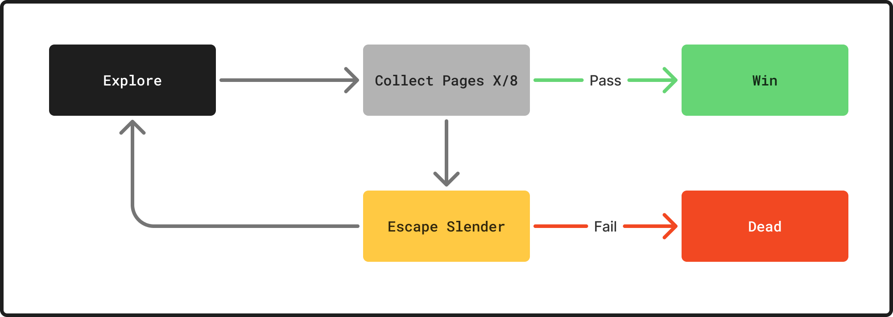
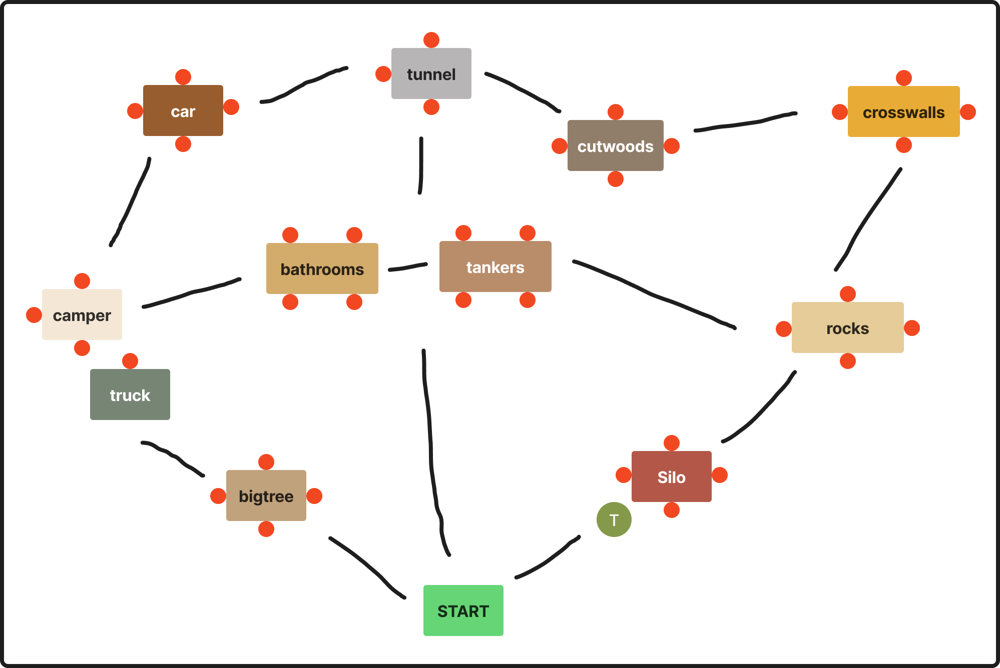
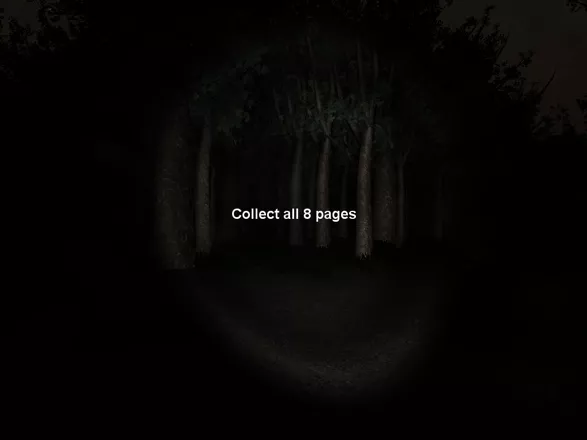

import Specs from "@/components/breakdowns/Specs.astro";
import Cycle from "@/components/breakdowns/Cycle.astro";
import LoopFlow from "@/components/breakdowns/LoopFlow.astro";
import TensionGraph from "@/components/breakdowns/TensionGraph.astro";

## Game Overview

<Specs
  items={[
    ["Genre", "Survival horror"],
    ["Perspective", "First-person"],
    ["Player count", "Single-player"],
    ["Objective", "Collect 8 pages and survive"],
    ["Setting", "Forest at night"],
    ["Core fantasy", "Being hunted by something you cannot fight"],
  ]}
/>

## Core Loop

The core loop has three parts:

- **Explore** the world
- **Collect** 8 pages
- **Escape** Slender Man

You win if you collect 8 pages; you lose if Slender Man gets to you first.

Further broken down into the following player decisions:

- **Explore**: Where should I go?
- **Navigate**: Am I navigating towards a useful landmark?
- **Observe**: How long can I stay here? Is Slender Man nearby?
- **React**: Do I keep searching, flee, or change direction?
- **Resource**: Do I use my flashlight? Do I sprint?
- **Recover**: When is it safe to resume exploration?

## Game Mechanics

### Player Mechanics

**Movement**

- Walk
- Sprint
- Camera movement
- Zoom: the player can zoom in to focus on a distance

**Flashlight**

- Toggle ON/OFF
- Limited battery
- Provides visibility
- Contributes to player "vulnerability and awareness"

**Interaction**

- Pick up page

### Page System

- **8** pages required
- Pages are distributed across landmarks
- Page collection is the primary progression
- Collection of pages causes Slender Man's threat to escalate
- Pages also provide visual and narrative flavour but primarily act as progressor objects

#### Q1. Why pages?

The original game needed a collectable with the functions:

- Give the player **a reason to explore**
- Be **virtually invisible** in the dark forest
- Work without adding an inventory system
- Give the player **lore/evidence** about Slender Man
- Reinforce the game's central fantasy

A page object satisfies all the functions because it's **information**.

#### Q2. Why 8?

- A **gameplay pacing number**
- Establish a long enough exploration loop
- Allow threat escalation across page collection

### Slender Man System

This system can be broken down into 4 primary aspects:

- **Presence:** *"Is he here?"*
  - Slender Man can exist near the player without being visible
  - Player cannot reliably track his position
  - His presence is communicated through visual and audio distortions.
- **Appearance:** *"Where is he?"*
  - His location is uncertain, only that he can appear around the map in his designated teleport zones
  - Can be encountered at varying distances and angles
- **Threat:** *"What happens if I see him?"*
  - Looking at Slender Man causes visual distortion
  - **Prolonged observation will result in the player's death**
  - The player has to look away and run and not confront him
- **Escalation:** *"How much worse is it getting?"*
  - Collecting a page increases progress.
  - Remaining too long without collecting a page also creates progress. **After approx 5 minutes without collecting a page, Slender Man can become active.**
  - Progress in escalation for Slender Man:
    - Movement speed
    - Teleport frequency
    - Aggression: more dangerous positioning, more aggressive player pursuit

Documented community thresholds of page collection progress:

| Pages | Slender Man |
| --- | --- |
| 0-1 | Passive, low encounter |
| 2 | Increased movement speed |
| 5 | Teleport frequency increased, faster movement |
| 7 | Increased aggression across all parameters |

> The thresholds are to be treated as reverse-engineered and not absolute.

## The Map

- There are ~10 recognisable landmarks on the map.
- The red circles around landmarks indicate page spawns; only one of those red dots per location will have a page spawned in.
- The tree with the T symbol near the silo is a guaranteed page spawn.
- Randomise page spawns in a set location to ensure that the page still spawns at that location but changes the position and keeps the game replayable and tense on every playthrough instead of a game of remembering page locations.

## Navigation

Demands the player build their own navigation system through failure.

- Landmarks are recognised based on the way they look: truck, tanker, bathrooms, rocks, silo, tunnel, etc.
- The player forms a mental map through failure; they start with not knowing where they are and form a mental map as the game progresses through runs: truck, then bathroom, then giant tree, etc.
- The only way the player would remember the mental map is through landmarks and their general directions. The flow would go like:

> I went north from spawn, I found tankers, I went left, found bathrooms.

*The level is super dark, and nothing outside the flashlight's range is visible.*

## Resources

### Sprint stamina

<Specs
  items={[
    ["Purpose", "Enables escape from Slender Man and creates a cost to sustained movement"],
    ["Constraint", "Sprint consumes stamina. Running cannot be sustained indefinitely. Stamina requires a recovery period before the player can sprint effectively again."],
    ["Recovery", "Stamina does not begin to regenerate immediately after prolonged sprinting: there is a ~1-2s recovery delay. After exhausting stamina, the player may need ~15-20s before completely returning to sustained sprinting again."],
    ["Design consequence", "Sprinting becomes an escape resource the player spends during the game. Spending it during normal exploration can leave the player vulnerable when Slender appears."],
    ["Player decision", "Sprint now or preserve stamina for a future encounter."],
  ]}
/>

### Flashlight

<Specs
  items={[
    ["Purpose", "Provides limited visibility while creating uncertainty and tension"],
    ["Constraint", "Flashlight battery is finite. Turning the flashlight OFF preserves battery but significantly reduces environmental visibility."],
    ["Design consequence", "Limited battery transforms visibility into a resource. The player must trade environmental awareness for long-term battery availability."],
    ["Player strategy", "During safe periods, turn off the flashlight to save battery. During navigation, the flashlight is used to identify landmarks and orient themselves. During encounters, it's important to see where they are going while escaping."],
    ["Player decision", "Do I need to see right now, or should I save the battery?"],
  ]}
/>

## Design Analysis

### Core design philosophy

The game is designed around creating vulnerability through uncertainty. Rather than giving the player the ability to confront the threat, it places them in an environment they don't understand and gives them an objective that requires continued exposure to it.

This can be inferred because of the following:

- Player has limited info
- Player has no offensive capability
- Player must explore to progress
- Exploration creates opportunities for Slender Man to appear
- Slender Man becomes increasingly dangerous as progress is made
- The player gradually learns the environment through repeated exposure

### Player psychology

The thought each system puts in the player's head:

| System | Player thought |
| --- | --- |
| Dark forest | Where am I? |
| Landmark | Maybe there's a page here |
| Page | Okay, 7 left |
| Static | Is Slender Man nearby? |
| Slender sighting | Oh, NO! |
| Sprint | RUN |
| Lost | Where am I now? |
| Next landmark | Let's keep going |

<Cycle steps={["Curiosity", "Uncertainty", "Anticipation", "Fear", "Relief", "Curiosity"]} />

### Pacing

The collection of pages controls pacing and directly influences Slender Man's behaviour. Plotting the graph of player tension vs pages:

<TensionGraph
  points={[10, 20, 40, 35, 45, 65, 60, 85, 100]}
  notes={[
    ["Page 1", "Lower baseline, player learning the environment"],
    ["Page 2", "Higher chance of a first encounter, tension rises"],
    ["Pages 3-4", "Player adaptation to environment, player's a little stable"],
    ["Page 5", "Spike in player aggression, increase in Slender AI parameters (movement + teleport frequency)"],
    ["Page 6", "Possible player adaptation to the new Slender AI"],
    ["Page 7", "Spike in player tension, aggression increase in Slender AI"],
    ["Page 8", "Maximum tension in the endgame"],
  ]}
/>

**The audio in-game also changes based on the pages collected, acting as a dynamic tension layer.**

### Why does the game work?

The flashlight creates tension because visibility is necessary for navigation, but the visibility is also limited. The player cannot maintain awareness of the surroundings and conserve battery at the same time. This makes the simple act of moving a resource-management decision.

This further becomes effective when combined with Slender Man's unpredictable positioning. The player navigates a dark forest without ever knowing whether the next area has Slender Man in it.

### Why does the objective make the player enter danger?

The player cannot remain in a safe location because progress requires exploration. Each page therefore represents progress towards completion and increased exposure to Slender Man.

This creates an interesting inversion of the conventional power fantasy. In many games, completing objectives makes the player stronger. In this game, completing objectives makes the threat stronger.

> Progress toward victory increases the difficulty of achieving victory.

### Why is Slender Man more effective when rarely seen?

Comes down to Presence vs Appearance. Slender Man's visual design is scary, but his effectiveness comes from the uncertainty surrounding his location.

This leads players to perform threat detection constantly. The game makes acquiring information about the threat dangerous, so dangerous that you can't even look at him.

### How do the systems create a feedback loop?

**Navigation + Stamina + Flashlight + Slender systems.** This combination of multiple systems creates a systemic horror loop.

<LoopFlow
  steps={[
    "You are lost",
    "Switch ON flashlight",
    "Flashlight drains battery",
    "Conserve it by switching it OFF",
    "Navigation becomes hard",
    "Slender Man appears",
    "Sprint to escape",
    "Stamina drains",
    "Escape successful",
    "You're now somewhere unfamiliar",
    "You have to reconstruct your location",
  ]}
  back={`"You are lost"`}
/>

### Why does the game remain scary despite repetition?

- **First encounter: Ignorance**
  - Player doesn't understand the map, page locations, Slender Man's behaviour, what makes him appear, how dangerous looking at him is, or how to escape.
  - Everything is uncertain.
- **Early learning: Understanding**
  - Player begins learning landmark locations, navigation routes, page locations, Slender Man's behaviour, how to conserve stamina and how to use the flashlight.
  - Game is now less mysterious.
- **Experienced player: Optimisation**
  - Experienced players now find the best route to gather all pages, know the best way to preserve the flashlight and conserve stamina, know every location on the map, and know exactly how Slender Man behaves.
  - The fear present in the game changes to execution now.

  Map knowledge <b class="up">↑</b>
  Enemy knowledge <b class="up">↑</b>
  Mechanical knowledge <b class="up">↑</b>
  Uncertainty <b class="down">↓</b>
  Fear <b class="down">↓</b>

The same knowledge that allows the player to survive also removes the uncertainty and fear it produced. The game also does not replace that uncertainty lost through mastery.

### Why does removing combat make the game scarier?

Combat gives the player:

- Agency
- Control
- A way to eliminate threats
- Feedback that their actions are effective
- Confidence in their ability to survive

Slender Man basically removes all of that. Encountering Slender Man is a situation the player survives; it's not something they are meant to solve/eliminate.

### What breaks down?

Looking closely, the game breaks down due to:

**Repetition.** Once the player understands the core loop, there aren't many new mechanics introduced.

**Limited player expression.** There are few things the player can do beyond exploring, managing stamina, managing the flashlight, avoiding looking at Slender Man, and running.

Slender Man is a very small game with a deliberately minimal scope, meant for players to finish in a sitting. From a long-term progression perspective, this is a flaw, but from a short-term perspective, this is intentional minimalism.

> It'd be very interesting to explore preserving uncertainty even after the player has learned all the underlying systems.

## Design Lessons

### Objectives can create vulnerability

A good objective gives the player something to accomplish and forces them into danger to do it.

### Combat and player power aren't always necessary for engagement

Removing combat can shift the player's focus from defeating threats to surviving them.

### Uncertainty is a resource

Information can be withheld to create tension, but revealing it should have a meaningful effect on the player.

### Escalation doesn't require new mechanics

The same core mechanics can produce escalating tension if the game's parameters change over time.

### Player knowledge is a design variable

The player's understanding of the map, mechanics, and enemy behaviour can heavily change the experience.

### Horror and mastery conflict

The more effectively players understand and optimise a horror game's systems, the more the uncertainty that created the horror can disappear.
