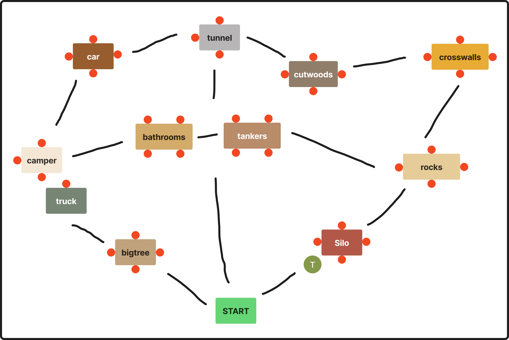

Lorem ipsum dolor sit amet, consectetur adipiscing elit. Sed do eiusmod tempor incididunt ut labore et dolore magna aliqua. Ut enim ad minim veniam, quis nostrud exercitation ullamco laboris nisi ut aliquip ex ea commodo consequat. This sentence has **bold words**, some *italic ones*, a bit of ***both***, ~~a struck-out idea~~, and a [link to the breakdowns](/portfolio/breakdowns).

Duis aute irure dolor in reprehenderit in voluptate velit esse cillum dolore eu fugiat nulla pariatur. Excepteur sint occaecat cupidatat non proident, sunt in culpa qui officia deserunt mollit anim id est laborum.

## A second-level heading

Curabitur pretium tincidunt lacus. Nulla gravida orci a odio. Nullam varius, turpis et commodo pharetra, est eros bibendum elit, nec luctus magna felis sollicitudin mauris. Integer in mauris eu nibh euismod gravida.

### A third-level heading

Praesent dapibus, neque id cursus faucibus, tortor neque egestas augue, eu vulputate magna eros eu erat. Aliquam erat volutpat. Nam dui mi, tincidunt quis, accumsan porttitor, facilisis luctus, metus.

#### A fourth-level heading

Phasellus ultrices nulla quis nibh. Quisque a lectus. Donec consectetuer ligula vulputate sem tristique cursus.

## Lists

An unordered list:

- Lorem ipsum dolor sit amet
- Consectetur adipiscing elit, with a longer line that wraps onto a second line to check how the page copes with it
- Nested items:
  - Integer molestie lorem at massa
  - Facilisis in pretium nisl aliquet
- Back to the first level

An ordered list:

1. Prototype it on paper first
2. Playtest with three people
3. Write down what surprised you
4. Throw half of it away

And a checklist:

- [x] Sketch the core loop
- [x] Build a greybox
- [ ] Find the fun
- [ ] Ship it

## A quote

> Lorem ipsum dolor sit amet, consectetur adipiscing elit. The best ideas arrive as margin notes.

Morbi in sem quis dui placerat ornare. Pellentesque odio nisi, euismod in, pharetra a, ultricies in, diam.

## Code

Some `inline code` in a sentence, then a block:

```ts
// A tiny state machine, the kind that ends up everywhere.
type State = "idle" | "walk" | "run";

function next(state: State, speed: number): State {
  if (speed === 0) return "idle";
  return speed > 5 ? "run" : "walk";
}
```

## A table

| Mechanic    | Verb   | Feels like            |
| ----------- | ------ | --------------------- |
| Sprint      | Run    | Panic, spent wisely   |
| Flashlight  | Look   | Safety, on a timer    |
| Pages       | Collect| Progress, and danger  |

## A photo

Sed lectus. Integer euismod lacus luctus magna. Here's a sketch of a map, taped in:



Quisque cursus, metus vitae pharetra auctor, sem massa mattis sem, at interdum magna augue eget diam.

---

## Footnotes

Vestibulum ante ipsum primis in faucibus orci luctus et ultrices posuere cubilia curae.[^1] Morbi lacinia molestie dui.[^2]

[^1]: A footnote, lorem ipsum dolor sit amet.
[^2]: And another, consectetur adipiscing elit.
