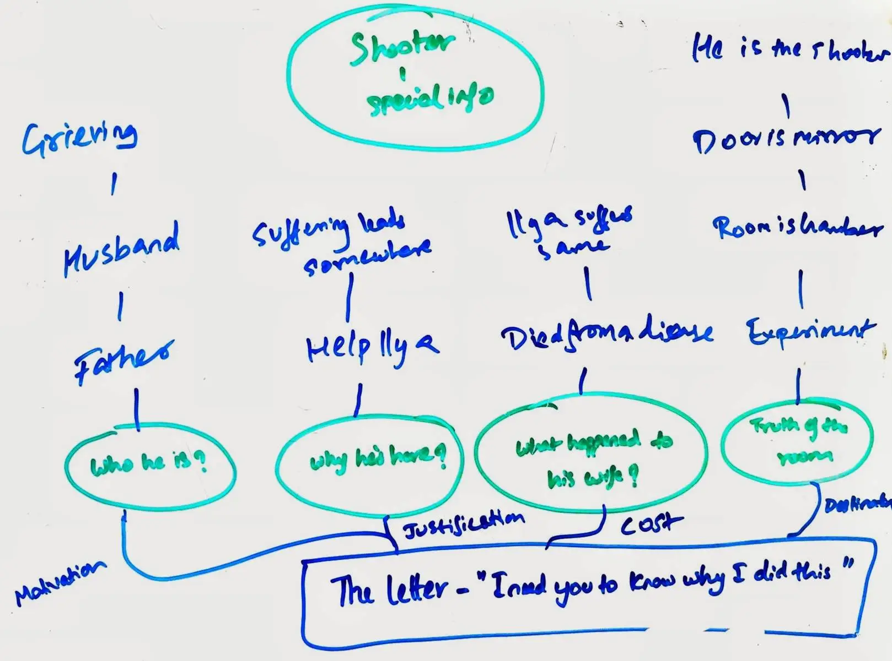

## Table of contents

## The beginning

Everything started with one idea: what if death itself was the mechanic for moving forward?

The original concept was built around repeated deaths and the traces each death left behind, inspired by *The Company of Myself*. I broke that game down level by level to understand how it introduced mechanics and story, then built the story around the mechanic.

> [!INFO] A different direction
> That prototype eventually became something very different.

---

## Finding the game

As I developed the idea, I got more interested in the loop itself than in death as a mechanic. I wanted repetition to mean something beyond retrying a level.

The game gradually became a psychological horror experience about a man trapped inside an endless loop, with the player reconstructing who he is and why he's there.

The key shift was making knowledge, rather than loop count, the source of progression. Each loop resets the room, but everything the player understands carries forward.

### From death to knowledge

| Original idea | Final direction |
| --- | --- |
| Death drives progression | Knowledge drives progression |
| Repeated deaths | Repeated loops |
| Memories of previous runs | Information carried between loops |
| Mechanical puzzle | Narrative mystery |
| Progress through repetition | Progress through understanding |

From there, the design grew around a small set of objects: a child's duck, a family portrait, a cloth, a broken stopwatch, a letter, and eventually the room itself. Each object reveals another piece of Angelo's life, and combinations between them unlock new information.

---

## Designing around discovery

I wanted the player to feel like they were figuring Angelo out, rather than being told his story. Every interaction had a purpose: objects could reveal memories, relationships, or fragments of dialogue. These discoveries gradually formed an information structure covering who Angelo was, why he volunteered for the experiment, what happened to his wife, what's happening to his daughter, and what's actually happening inside the room.

This also led to one of the game's core rules:

> [!TIP] Design principle
> Silence is information.

Not every combination produces a new discovery. The player has to work out why two pieces of information belong together; trying every combination gets them nowhere.

---

## From story to structure

Once the narrative was established, I worked through the game scene by scene and object by object, designing the interactions and their progression before moving into implementation. That included mapping the information tree, writing dialogue and diary entries, designing the letter's progression, defining how discoveries unlock new information, creating Figma mocks for individual interactions, and drawing the game's artwork and visual assets.

Because 17YA was a small personal project, I also took on the visual side myself. I drew the characters, objects, and environments, using the visual language to support the shift between Angelo's perception of the room and the reality behind it.

The narrative settled into a deliberate emotional progression: daughter, family, illness, grief, confession, acceptance, death.

The player begins by learning that Angelo is a father, then gradually discovers his family, his wife's death, his daughter's condition, and finally why he volunteered for the experiment. Only after that does the game ask the player to finish the letter.

By the end, the loop stops being the mystery and becomes the context for the story.

---

## What it became

The final design is a fixed-angle point-and-click psychological horror game where the player explores a single room, examines objects, connects pieces of information, and completes a letter to Angelo's daughter.

The horror is grounded in real human experimentation and Fatal Familial Insomnia. The room is a manifestation of Angelo's fractured perception. The shooter, the looping environment, and the final mirror reveal all grow out of that one idea.

### The final reveal

The ending brings everything back to the central theme. Once the letter is complete, the player discovers that the shooter has always been Angelo himself. In the mirror, he finally sees himself clearly and is given one final choice:

> Pull the trigger.

The loop, the shooter, the room, and Angelo's fractured perception all resolve into the same idea.

**[Read the story: the title, the wall text, and the letter](/portfolio/narrative/17ya)**

---

## What I learned

> [!NOTE] The biggest lesson
> A strong mechanic has to become the structure of the entire experience.

The project began with death as a mechanic and ended with knowledge as the mechanic. That change gave the loop its meaning: each repeat became a chance to understand a little more.

I also learned the value of designing the information structure before the content around it. Once I had the information tree and emotional progression mapped out, individual interactions got much easier to design because every object had a clear job.

Most of all, 17YA taught me that narrative design works best when the player does the connecting themselves. The player reconstructs the story from objects, interactions, silence, and eventually the words of a letter.
