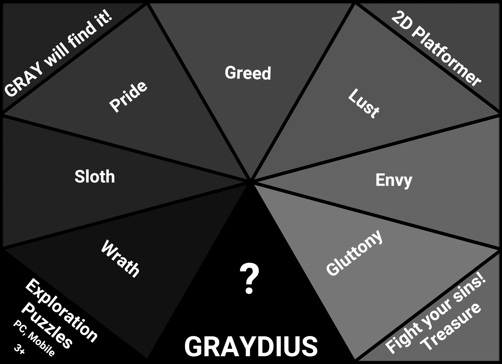

## Table of contents

## Project context

> [!INFO] Built in two days
> GRAYDIUS was a college project built in two days. We got a playable prototype running in that time, but the original build is no longer available. What remains is the design work, documentation, and the lessons I took from building it under such a tight constraint.

## The idea

GRAYDIUS started from a question: what if the power you gained was also the thing that slowly destroyed you?

I wanted to build a fast-paced 2D platformer around exploration, combat, puzzle solving, and a story about the seven deadly sins. The player takes the role of GRAY, the latest in a long line of treasure hunters searching for a legendary treasure none of her ancestors ever found.

When a mysterious cave appears in the remote town of Aileth, GRAY sees it as one last chance to finish what her family started. She enters looking for treasure. What she finds is something much more dangerous.

---

## The seven worlds

The cave connects seven different areas, each representing one of the seven deadly sins. Each world has its own environment, boss, story, and gameplay challenges.

| Sin | World | Core ability |
| --- | --- | --- |
| Pride | War Arena | Tracking projectiles |
| Greed | Treasure Kingdom | Coin barrage |
| Lust | Wedding Church | Falling projectiles |
| Envy | Ruined Courtyard | Rotating sword attacks |
| Gluttony | Kitchen | Enemy pull |
| Wrath | Prison | Teleporting attacks |
| Sloth | Throne Room | Summoned reinforcements |

The intention was for each boss to feel like more than a combat encounter. Every sin had its own history and its own reason for becoming what it was.

---

## Power was the progression

GRAY doesn't follow a traditional level progression system. Instead, every boss she defeats gives her a new ability. The player gradually builds an arsenal by overcoming the seven sins, with each ability changing how they approach combat and traversal. That made the bosses part of progression rather than obstacles standing between the player and the next level.

But there was a consequence: every time GRAY gained a new power, she became more corrupted.

---

## The cost of getting stronger

This is the part of GRAYDIUS I found most interesting. GRAY begins the game looking almost completely grey. As she defeats each sin, the corruption becomes more visible. Her appearance gradually darkens until, after carrying all seven sins, she's almost completely black. The power she gains is literally leaving a mark on her.

> [!TIP] Design principle
> The more powerful GRAY becomes, the less of herself remains.

The mechanic and the story move in the same direction. Progression makes the player stronger, and it also moves the character closer to losing herself.

---

## A world that tells the story

I wanted the worlds to communicate the sins without relying on exposition. A war arena represents Pride. A kingdom overflowing with treasure represents Greed. A wedding church becomes the setting for Lust. A ruined kingdom reflects Envy. A kitchen becomes the domain of Gluttony. A prison surrounded by lava houses Wrath. A throne room becomes the home of Sloth.

The bosses, their environments, enemy dialogue, and scattered collectibles all contribute pieces of their stories, so the player can learn what happened to these characters by exploring their worlds rather than being told through cutscenes.

---

## Designing the exploration

Exploration was built around revisiting places with new possibilities. The worlds contained collectibles and story fragments that could easily be missed, so backtracking let the player return after gaining new abilities and discover things they couldn't reach before.

I also experimented with day and night states, where the same area could contain different enemies, NPCs, collectibles, and exploration opportunities depending on the time. The goal was to make the levels feel like places that changed around the player.

---

## The twist

The treasure hunt eventually reveals its real cost. The gauntlet gives GRAY the power she needs to defeat all seven sins, but in doing so, it corrupts her completely.

After the final sin is defeated, GRAY confronts BLACK. BLACK is revealed to be GRAY's mother. She had gone looking for the same treasure years earlier and suffered the same fate, and the role of BLACK had been passed through the family, with each generation repeating the same journey. GRAY was never simply searching for the treasure; she was following her mother's footsteps.

---

## When the player becomes the enemy

After the reveal, control shifts away from GRAY. The player takes control of BLACK. The objective is simple: kill GRAY.

BLACK's purpose isn't to defeat her daughter out of hatred. She's trying to stop the cycle before GRAY completely loses herself.

The story jumps forward seventeen years. GRAY has become the new BLACK, waiting somewhere inside the same cave. Her daughter, ROSE, enters Aileth looking for her. The cycle begins again.

---

## What I learned

> [!NOTE] The biggest lesson
> Having many systems doesn't automatically create a cohesive game.

I wanted exploration, procedural generation, fast traversal, puzzles, backtracking, seven bosses, seven unique abilities, day and night systems, environmental storytelling, and a large narrative arc to all exist together. The individual ideas were exciting. The challenge was making them feel like one game.

The most valuable lesson was learning to look at every system through the same question: does this strengthen what the game is trying to say? The strongest part of GRAYDIUS was the connection between progression and corruption.

Building this in two days also taught me how quickly scope can overwhelm a good idea. I learned to identify the one or two ideas that make a project worth playing, then build around those before adding everything else.

---

## Project documents

### One pager

A visual overview of the game's concept, world, mechanics, and core experience. The textual version is below, along with the original pictorial version.

<a href="https://drive.google.com/file/d/1uBKyaXnzVLdiDpMM34MwTyj5HXZIKpbo/view?usp=sharing" target="_blank" rel="noopener noreferrer">View textual one pager</a>

### Feature brief

A brief pitch of one of the gameplay systems.

<a href="https://drive.google.com/file/d/1qovP7X1EZEreBw6xLwh7kJghKn_8yNZe/view?usp=sharing" target="_blank" rel="noopener noreferrer">View feature brief</a>

### Original game design document

An early GDD showing how GRAYDIUS was originally designed and how the project evolved from that direction.

<a href="https://drive.google.com/file/d/1YZpzFq9QCggU_nFDbvY_Fiwr69gQRrRF/view?usp=sharing" target="_blank" rel="noopener noreferrer">View original GDD</a>
