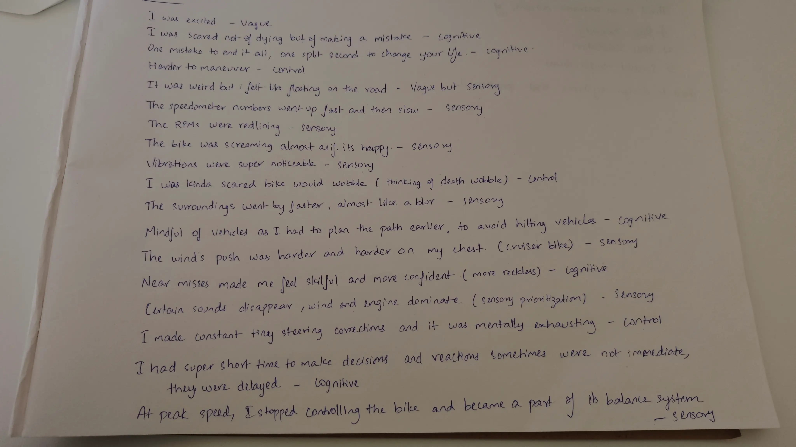
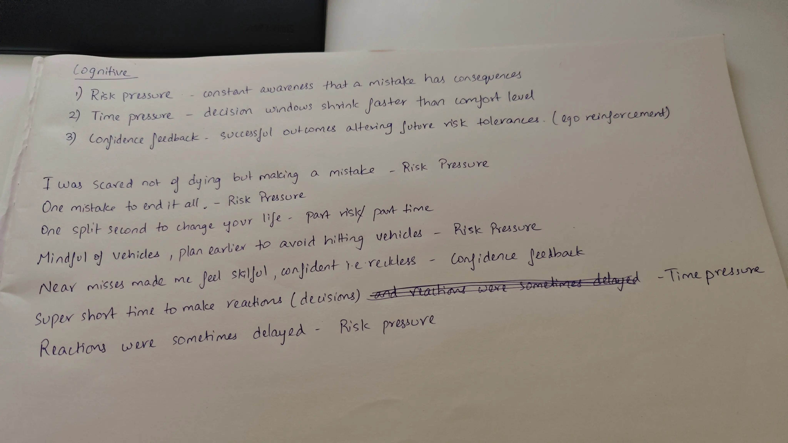
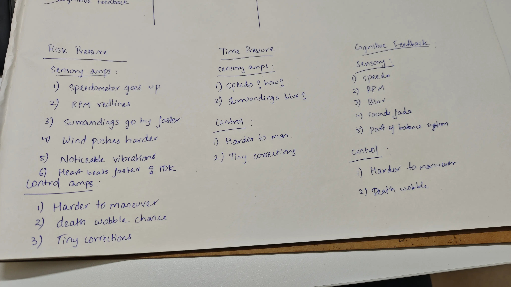

## Table of contents

## The idea

Night Riders started from a question: what does riding a motorcycle actually feel like at night?

I ride motorcycles myself, and I wanted to recreate those small feelings that come with riding inside a game. Instead of starting with a genre and adding mechanics around it, I started by writing down what I feel while riding, categorizing those feelings, and asking how each one could become something the player could interact with.

The result is a 2D first-person game where going faster lets you see further. You read headlights before you can tell what's behind them, scrape past obstacles, recover from wobbles, and push the bike further than feels comfortable.

---

## Turning feelings into mechanics

The most important part of the project was translating the experience of riding a motorcycle into systems.

Speed creates confidence, darkness creates uncertainty, and a vehicle appearing in the distance creates a split-second decision. A near miss creates adrenaline. A scrape doesn't necessarily mean failure; sometimes you barely get away with it and keep going. Losing control of the bike is different from crashing: there's a moment where you're still riding, but fighting to recover.

I wrote those feelings down and sorted them into categories.

---

## The central tradeoff

The game's most important mechanic came from a contradiction: the faster you go, the more you can see.

I got the idea from my old bike, a Honda Unicorn. Its headlight was tied to the engine, so the faster I went, the more power it made and the brighter the light got.

Applying the same concept, at high speed, the headlight reaches further and obstacles become visible earlier, but the bike becomes harder to control, lane changes get heavier, and mistakes get more punishing. At lower speeds, the bike is easier to move, but visibility collapses.

That creates a constant decision: slow down and stay safe, or go faster and see what's coming? The player is never given perfect information.

---

## Making near misses matter

I didn't want collisions to be binary, so the game treats scraping as a valid part of riding. Passing extremely close to an obstacle can cause a small loss of speed, accumulate damage, and potentially trigger a wobble. The player survives, but their bike is now in a worse state.

That creates situations where the best outcome isn't necessarily a perfect dodge. Sometimes you scrape through. Sometimes you barely recover. Sometimes you take the hit and keep moving. The goal is to make survival feel imperfect: a mistake costs you something without ending the run.

---

## The wobble

A scrape or side impact can trigger the wobble system: the bike begins drifting unpredictably while the ride continues, and the player has to respond to directional inputs rhythmically to stabilize it. Correct inputs reduce the duration and speed loss; missed inputs increase instability and damage.

The important part is that the player is still riding while this happens. The game doesn't pause and ask the player to complete a minigame. The instability becomes another problem layered on top of everything else happening on the road.

---

## Reading the darkness

The road is designed around ambiguous information. A pair of headlights might belong to a normal car, an approaching vehicle, or something that only looks like one. A silhouette might resolve into an obstacle at the last possible moment. Rain, reflections, signs, and other visual noise can briefly resemble genuine threats before revealing themselves as harmless.

The player has to learn to distinguish between what looks dangerous and what actually is. The game is meant to make them better at deciding with incomplete information.

---

## A road that fights back

The road is consistent, but the traffic is procedurally generated. That lets each run create different combinations of vehicles, road hazards, and close calls without requiring a completely authored track every time.

Slowing down also has a cost. In more dangerous sections, losing speed can place the player into denser and more chaotic traffic, which creates another pressure: stopping is safer mechanically, but staying fast can be safer strategically. The player is constantly encouraged to maintain momentum.

---

## Damage changes the ride

As the bike takes damage, its headlight range, stability, and visual clarity degrade, so the bike communicates its condition through the experience itself: it sees less, becomes harder to control, and makes the darkness feel more threatening.

That means the consequences of a mistake feed directly back into the central mechanic: less control leads to less visibility, which leads to more uncertainty and more risk.

---

## Designing the visual language

The game uses a 2D first-person perspective, with the road represented in 3D and the surrounding environment presented through 2D elements. The visual direction is dark and desaturated, relying heavily on the contrast between the headlight and everything outside it.

The bike and its condition are part of the feedback system: damage can affect the lighting, while speed can introduce motion blur and tunnel vision. The goal is to make the player feel like their field of vision is being pushed beyond what's comfortable.

---

## The design influence

While developing the concept, I rode the motorcycle at night and broke down what made it feel fast and what made it feel satisfying.

The important lesson was that speed alone doesn't create the feeling of speed; the player needs constant visual and physical feedback to understand how fast they're moving. That research pushed me toward stronger feedback systems.

---

## From prototype thinking to the playable concept

The project went through several different directions before becoming Night Riders. An earlier version, Only Forward, explored motorcycle riding as a psychological horror experience built around memory, denial, and a looping road, with a design focused on mirrors, fuel, weather, hallucinations, and behavior-driven narrative events.

The concept eventually shifted away from horror and toward the physical experience of riding itself. What survived was the feeling of darkness, speed, uncertainty, and the compulsion to keep moving. The narrative loop became a gameplay loop, and the road stopped being a metaphor for memory and became a system built around risk, visibility, and momentum.

---

## What I learned

The biggest lesson from Night Riders was that personal experience can be a useful design tool when you translate it into mechanics.

I didn't want to make a motorcycle simulator that copied real riding. I wanted to identify the moments that made riding feel exciting, uncomfortable, risky, or satisfying, then find the simplest mechanics that could create those feelings for the player. That process changed how I approach mechanic design: instead of asking what mechanic a game should have, I started asking what the player should feel, and what system could make them feel it.

---

## Project context

> [!INFO] Personal design experiment
> Night Riders grew directly out of my own experience riding motorcycles. I wrote down and categorized the feelings I associated with riding, then translated those feelings into gameplay systems.
>
> The current concept is designed as a 2D first-person experience, combining high-speed arcade racing with risk, survival, and replayability.

---
