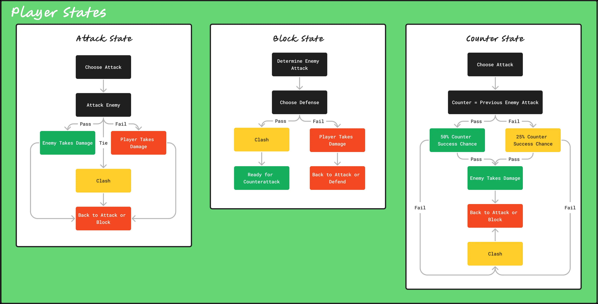
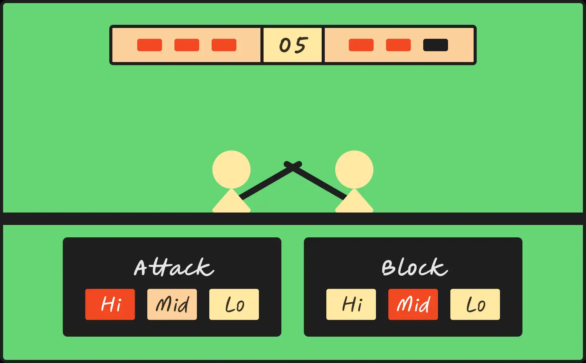

import ResponsiveTable from "@/components/ResponsiveTable.astro";

## Table of contents

## Controls

| Keys | Action |
| --- | --- |
| W / D / S | High / Mid / Low Attack |
| Up / Right / Down Arrow | Defend High / Mid / Low |

Attack and defend each use the same up-center-down logic, just on different halves of the keyboard, so the mapping only has to be learned once. Your pick can be changed freely until the countdown hits zero.

---

## The idea

This was a small combat experiment built around one question: what if a samurai duel was decided by Rock Paper Scissors?

The basic system started with three attack positions: High, Mid, Low. That alone felt too simple. I added Block, giving the player a second way to respond to an opponent's choice without losing the simplicity of the three-position system. The result was a duel focused less on reaction speed and more on reading your opponent and predicting their next move.

---

## The core system

The combat system revolves around three attack positions, High, Mid, and Low, each interacting with the others in a Rock Paper Scissors style system. The player can choose to attack or block, which gives them different ways to approach each exchange: a simple set of rules to understand, with more possibilities inside those rules than it first looks like.

The interesting decision is figuring out what your opponent is going to do.

---

## Attack and block

The two player states give the duel its depth.

Attack lets the player commit to a High, Mid, or Low strike and try to land damage on the opponent.

Block lets the player read the opponent's attack and choose a corresponding defensive position. A successful block stops the attack outright, while a failed read leaves the player vulnerable.

The result is a small decision tree built around a simple set of inputs. Here's the full outcome table, player 1's choice down the left side against player 2's choice along the top:

<ResponsiveTable>
<table class="text-xs">
<thead>
<tr>
<th class="border border-border bg-muted/40 p-1.5 text-left font-semibold">P1 \ P2</th>
<th class="border border-border bg-muted/40 p-1.5 font-semibold">Hi Slash</th>
<th class="border border-border bg-muted/40 p-1.5 font-semibold">Mid Slash</th>
<th class="border border-border bg-muted/40 p-1.5 font-semibold">Lo Slash</th>
<th class="border border-border bg-muted/40 p-1.5 font-semibold">Hi Defend</th>
<th class="border border-border bg-muted/40 p-1.5 font-semibold">Mid Defend</th>
<th class="border border-border bg-muted/40 p-1.5 font-semibold">Lo Defend</th>
</tr>
</thead>
<tbody>
<tr>
<th class="border border-border bg-muted/40 p-1.5 whitespace-nowrap text-left font-semibold">Hi Slash</th>
<td class="border border-border bg-amber-400/25 p-1.5 text-center font-medium whitespace-nowrap text-amber-800 dark:text-amber-300">Clash</td>
<td class="border border-border bg-violet-500/20 p-1.5 text-center font-medium whitespace-nowrap text-violet-700 dark:text-violet-300">P2 wins</td>
<td class="border border-border bg-violet-500/20 p-1.5 text-center font-medium whitespace-nowrap text-violet-700 dark:text-violet-300">P1 wins</td>
<td class="border border-border bg-sky-500/20 p-1.5 text-center font-medium whitespace-nowrap text-sky-700 dark:text-sky-300">Blocked</td>
<td class="border border-border bg-red-500/15 p-1.5 text-center whitespace-nowrap text-red-700 dark:text-red-300">P1 takes damage</td>
<td class="border border-border bg-red-500/15 p-1.5 text-center whitespace-nowrap text-red-700 dark:text-red-300">P1 takes damage</td>
</tr>
<tr>
<th class="border border-border bg-muted/40 p-1.5 whitespace-nowrap text-left font-semibold">Mid Slash</th>
<td class="border border-border bg-violet-500/20 p-1.5 text-center font-medium whitespace-nowrap text-violet-700 dark:text-violet-300">P1 wins</td>
<td class="border border-border bg-amber-400/25 p-1.5 text-center font-medium whitespace-nowrap text-amber-800 dark:text-amber-300">Clash</td>
<td class="border border-border bg-violet-500/20 p-1.5 text-center font-medium whitespace-nowrap text-violet-700 dark:text-violet-300">P2 wins</td>
<td class="border border-border bg-red-500/15 p-1.5 text-center whitespace-nowrap text-red-700 dark:text-red-300">P1 takes damage</td>
<td class="border border-border bg-sky-500/20 p-1.5 text-center font-medium whitespace-nowrap text-sky-700 dark:text-sky-300">Blocked</td>
<td class="border border-border bg-red-500/15 p-1.5 text-center whitespace-nowrap text-red-700 dark:text-red-300">P1 takes damage</td>
</tr>
<tr>
<th class="border border-border bg-muted/40 p-1.5 whitespace-nowrap text-left font-semibold">Lo Slash</th>
<td class="border border-border bg-violet-500/20 p-1.5 text-center font-medium whitespace-nowrap text-violet-700 dark:text-violet-300">P2 wins</td>
<td class="border border-border bg-violet-500/20 p-1.5 text-center font-medium whitespace-nowrap text-violet-700 dark:text-violet-300">P1 wins</td>
<td class="border border-border bg-amber-400/25 p-1.5 text-center font-medium whitespace-nowrap text-amber-800 dark:text-amber-300">Clash</td>
<td class="border border-border bg-red-500/15 p-1.5 text-center whitespace-nowrap text-red-700 dark:text-red-300">P1 takes damage</td>
<td class="border border-border bg-red-500/15 p-1.5 text-center whitespace-nowrap text-red-700 dark:text-red-300">P1 takes damage</td>
<td class="border border-border bg-sky-500/20 p-1.5 text-center font-medium whitespace-nowrap text-sky-700 dark:text-sky-300">Blocked</td>
</tr>
<tr>
<th class="border border-border bg-muted/40 p-1.5 whitespace-nowrap text-left font-semibold">Hi Defend</th>
<td class="border border-border bg-sky-500/20 p-1.5 text-center font-medium whitespace-nowrap text-sky-700 dark:text-sky-300">Blocked</td>
<td class="border border-border bg-red-500/15 p-1.5 text-center whitespace-nowrap text-red-700 dark:text-red-300">P2 takes damage</td>
<td class="border border-border bg-red-500/15 p-1.5 text-center whitespace-nowrap text-red-700 dark:text-red-300">P2 takes damage</td>
<td class="border border-border bg-muted/10 p-1.5 text-center whitespace-nowrap text-muted-foreground italic">None</td>
<td class="border border-border bg-muted/10 p-1.5 text-center whitespace-nowrap text-muted-foreground italic">None</td>
<td class="border border-border bg-muted/10 p-1.5 text-center whitespace-nowrap text-muted-foreground italic">None</td>
</tr>
<tr>
<th class="border border-border bg-muted/40 p-1.5 whitespace-nowrap text-left font-semibold">Mid Defend</th>
<td class="border border-border bg-red-500/15 p-1.5 text-center whitespace-nowrap text-red-700 dark:text-red-300">P2 takes damage</td>
<td class="border border-border bg-sky-500/20 p-1.5 text-center font-medium whitespace-nowrap text-sky-700 dark:text-sky-300">Blocked</td>
<td class="border border-border bg-red-500/15 p-1.5 text-center whitespace-nowrap text-red-700 dark:text-red-300">P2 takes damage</td>
<td class="border border-border bg-muted/10 p-1.5 text-center whitespace-nowrap text-muted-foreground italic">None</td>
<td class="border border-border bg-muted/10 p-1.5 text-center whitespace-nowrap text-muted-foreground italic">None</td>
<td class="border border-border bg-muted/10 p-1.5 text-center whitespace-nowrap text-muted-foreground italic">None</td>
</tr>
<tr>
<th class="border border-border bg-muted/40 p-1.5 whitespace-nowrap text-left font-semibold">Lo Defend</th>
<td class="border border-border bg-red-500/15 p-1.5 text-center whitespace-nowrap text-red-700 dark:text-red-300">P2 takes damage</td>
<td class="border border-border bg-red-500/15 p-1.5 text-center whitespace-nowrap text-red-700 dark:text-red-300">P2 takes damage</td>
<td class="border border-border bg-sky-500/20 p-1.5 text-center font-medium whitespace-nowrap text-sky-700 dark:text-sky-300">Blocked</td>
<td class="border border-border bg-muted/10 p-1.5 text-center whitespace-nowrap text-muted-foreground italic">None</td>
<td class="border border-border bg-muted/10 p-1.5 text-center whitespace-nowrap text-muted-foreground italic">None</td>
<td class="border border-border bg-muted/10 p-1.5 text-center whitespace-nowrap text-muted-foreground italic">None</td>
</tr>
</tbody>
</table>
</ResponsiveTable>

Colors group outcomes: amber for a clash, violet for a clean win, red for taking damage, sky blue for a successful block.

---

## Reading the opponent

The duel is ultimately about prediction. The player never knows exactly what the opponent has selected, so every decision is made with incomplete information. You might attack High expecting a Low attack, or block Mid expecting the opponent to strike there.

That creates a simple psychological loop: what did they do, what will they do next, what do they think I'll do. The controls stay simple while the decisions become about reading the other player.

---

## The duel

The visual design was kept deliberately minimal. Two samurai face each other with very little separating them, so the focus stays on the choices being made. The interface shows the chosen High, Mid, and Low choices clearly at the bottom left, while the underlying state system determines how the exchange resolves.
---

## What I learned

This experiment taught me that depth doesn't necessarily come from adding more mechanics. The original High, Mid, and Low system was easy to understand, but it didn't create enough interesting decisions on its own. Adding Block expanded the decision space while keeping the core interaction simple.

It also showed me how much depth can come from prediction, uncertainty, and player psychology. The interesting part of the duel is figuring out what the other player is thinking.

---

## Teaching the opponent to read you

The enemy originally just rolled dice. Every round it picked attack, defend, or idle off three random numbers, with no memory of anything the player had done. It was a fair fight, but not a very interesting one.

The fix came from hand-cricket, a game where the "AI" is a person who's actually watching you. A human opponent in hand-cricket doesn't guess randomly. They notice you attack right after you defend, or that you've gone reckless with three attacks in a row, or that you're trying to break your own pattern to throw them off. All of that is learnable too.

So the enemy now keeps a record of what you tend to do. It tracks what you usually play right after each of your own moves, and falls back to your overall habits early on when it doesn't have enough data yet. The more you play against it, the sharper its reads get, though its confidence is capped so it's never fully certain. That cap leaves room for your own pattern-breaking to occasionally land.

Its memory persists across matches, saved to a file rather than wiped every time you close the game. There's a reset built in too, in case you want to face a fresh opponent again, or the AI gets a little too good at reading you.

## Showing your hand, and theirs

Once the enemy was reading the player, only one side of the duel had any information to act on. A small readout fixed that, showing what the enemy expected you to do that round, whether or not it was confident enough to act on the read.

That one piece of information changes the loop. Once you notice the enemy is watching your habits, you can deliberately play against your own pattern to bait it into the wrong counter. It's the same mutual bluff that makes hand-cricket interesting in the first place, just made visible.

## Why a smart AI can't play its best move every time

Showing the enemy's read created a new problem. If the enemy always throws the mathematically correct counter to its prediction, a sharp player doesn't even need to out-think the enemy's read of them. They just need to learn the enemy's own fixed response to that read, and throw the one move that beats it. An AI that's always "right" becomes a puzzle with one solution.

The fix is the same idea behind bluffing in poker or mix-ups in a fighting game: if an opponent can learn your decision rule, always playing your single best response turns that rule into the exploit. So the enemy now mixes its answer. Most of the time it still plays the textbook counter, because that's the move that's right most often. The rest of the time it either mirrors the height it predicted, which punishes a player who's learned the textbook counter, or throws the third option, just to keep that pattern from being fully mapped out either.

It's a slightly worse move on average, in the rounds where the enemy's read was correct. That's the price of staying unpredictable, and for a game built around reading your opponent, it's the right trade.

## Why defend isn't just a fourth option

The High-Mid-Low attack cycle on its own is reskinned Rock Paper Scissors: three choices in a closed loop, none structurally different from the others. That loop by itself doesn't reward thinking about what the other player is thinking, any more than the classic hand game does.

Defend breaks that symmetry. An attack is always a bet inside the three-way cycle, beating one height and losing to one height, same as any RPS throw. Defend doesn't work that way. It deals no damage on its own, and it only pays off by matching the opponent's attack exactly. Choosing to defend is a direct claim about what the other player is about to do in a way that choosing an attack height never has to be. That second axis, attack-versus-attack on one side and attack-versus-defend mind games on the other, is what the AI's prediction system and the player's own bluffing are actually playing on.

## Design documentation

### Player states

A breakdown of the different player states and how attacks, blocks, and clashes resolve. A Counter state was part of this early design but was cut, since it ended up doing the same job as block and wasn't worth the extra scope.

### Game view

A visual exploration of the duel interface, showing the High, Mid, and Low choices available to both players.

