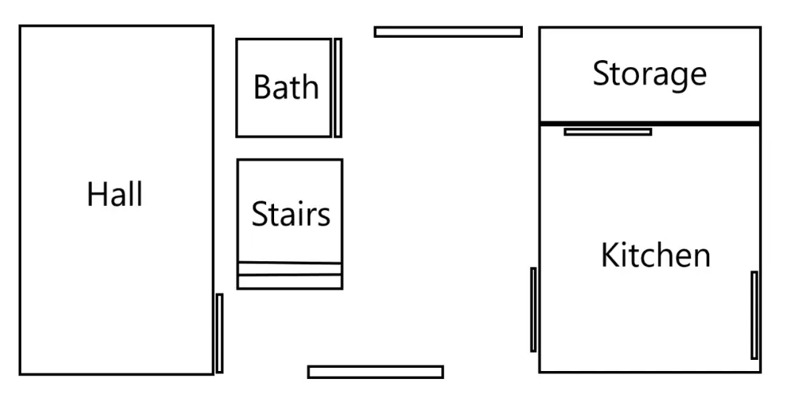
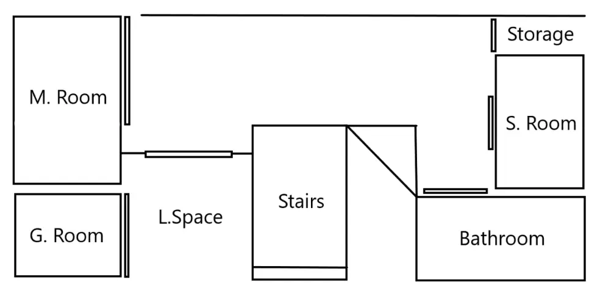

## Table of contents

## The project

SVTCH is a short first-person horror survival experience about a little girl named Amber, who wakes up alone in her house in the middle of the night after hearing strange noises. The entire experience takes place inside the house as Amber explores and solves small puzzles.

> [!INFO] Project context
> SVTCH was a one-week college project. I was primarily responsible for the story, level design, and room layout, while also learning and working with lighting and baked lighting in Unity.
>
> We built a playable prototype during the week, but the original build is no longer available. The documentation below preserves the design and development work from the project.

---

## Designing the house

The house was the main tool I had for controlling the player's experience. I designed the room layouts and the connections between spaces to guide Amber through a linear sequence while still making the house feel like a believable place.

<figure style="margin:0;">

<figcaption style="text-align:center;margin-top:0.5rem;">Ground Floor</figcaption>
</figure>

<figure style="margin:0;">

<figcaption style="text-align:center;margin-top:0.5rem;">First Floor</figcaption>
</figure>

The player starts in the small bedroom and gradually moves through the house, visiting hallways, bedrooms, storage rooms, the kitchen, and eventually the basement.

---

## Creating tension through space

I wanted the horror to come from anticipation rather than constant jumpscares. The player is given ordinary reasons to move through the house, but each trip into another room introduces something slightly more unsettling: a power fluctuation, a strange sound, a shadow, a door closing behind you. Eventually, the player encounters something more sinister.

---

## Learning lighting

SVTCH was also a chance for me to learn more about lighting in Unity. I worked with placing and balancing lights, creating darker areas for tension, and baking the lighting for the environment. That made me realize lighting could be part of the level design itself.

A hallway doesn't need anything in it to feel threatening. Changing what the player can see, how far they can see, and where the safe areas of light end can completely change how they move through the space.

---

## The breath mechanic

The main survival mechanic was built around a simple idea: the Shades can sense your breath.

Amber can hold her breath for a set amount of time, making her invisible to the Shades while she does so. Holding your breath darkens the screen while Amber's heartbeat becomes increasingly noticeable, creating a small window of safety the player has to use carefully.

The breath mechanic started as a standalone prototype I built to explore tension through limited breathing, which eventually became the foundation for SVTCH.

**[View the original breath mechanic prototype](/portfolio/coding/breath-hold)**

---

## What I learned

SVTCH taught me that level design can carry narrative and emotion without relying on dialogue or cutscenes. The layout of a house can control where the player goes, how long they spend somewhere, and how vulnerable they feel while moving through it.

Working with lighting also taught me that environment design and atmosphere are closely connected: the way a space is lit can completely change how the same room is perceived.

Most of all, working on a one-week project taught me how to make design decisions quickly and focus on the elements that actually contribute to the intended experience.

---

## Project documents

### One pager

A visual overview of the game's concept, story, mechanics, and intended experience.

<a href="https://drive.google.com/file/d/1yBMCHdyCVBxhmzSaBXfzEBPLIQJs282p/view" target="_blank" rel="noopener noreferrer">View one pager</a>

### Feature brief

A brief pitch of one of the gameplay systems.

<a href="https://drive.google.com/file/d/1V9YFHVYasquG-yjqPxIu8Wl1aPfPYVEC/view" target="_blank" rel="noopener noreferrer">View feature brief</a>

### Original game design document

The original GDD covering SVTCH's gameplay loop, level design, core mechanics, story, characters, and systems.

<a href="https://drive.google.com/file/d/1opimfTIefAQJHbDT5vZ9JiYmP1-Gsqkp/view" target="_blank" rel="noopener noreferrer">View original GDD</a>
